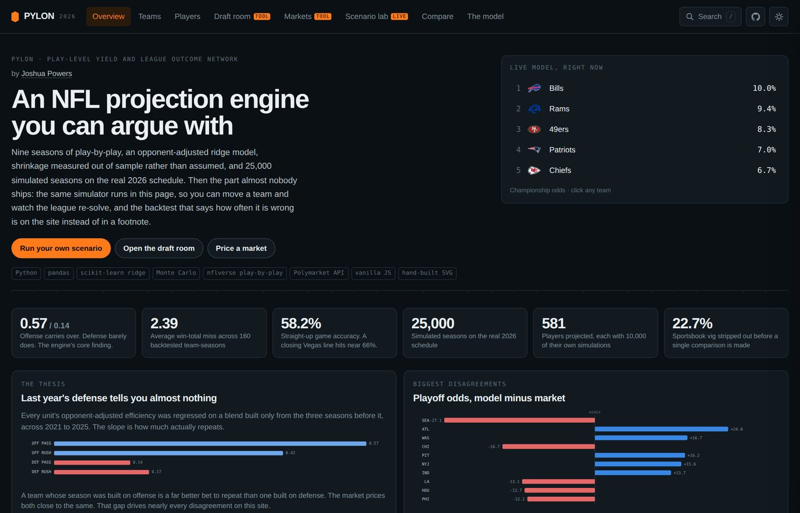
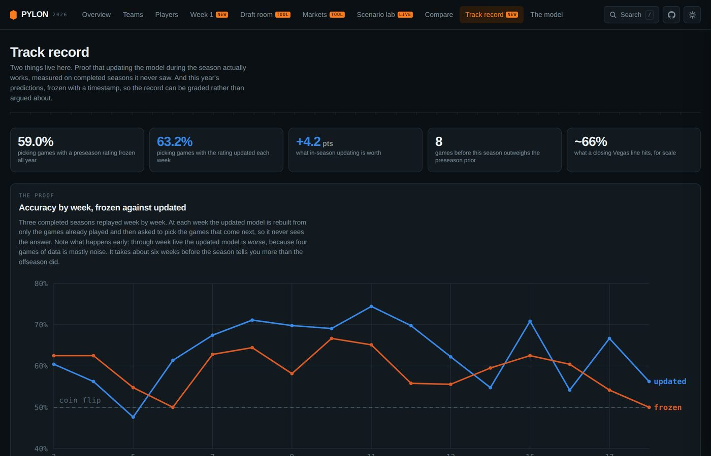
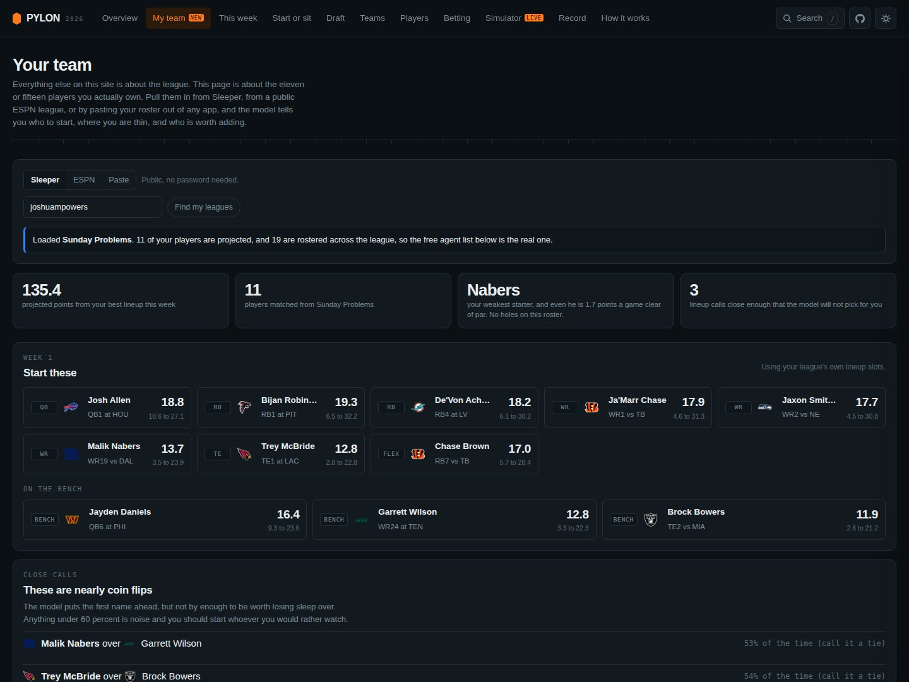
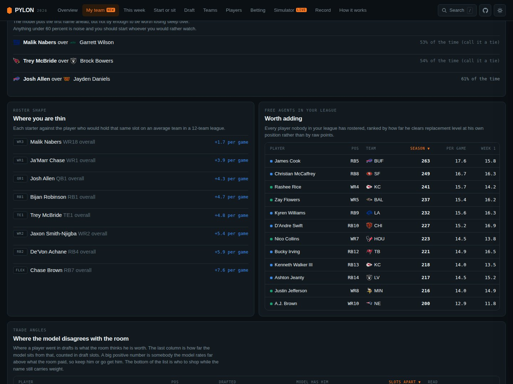
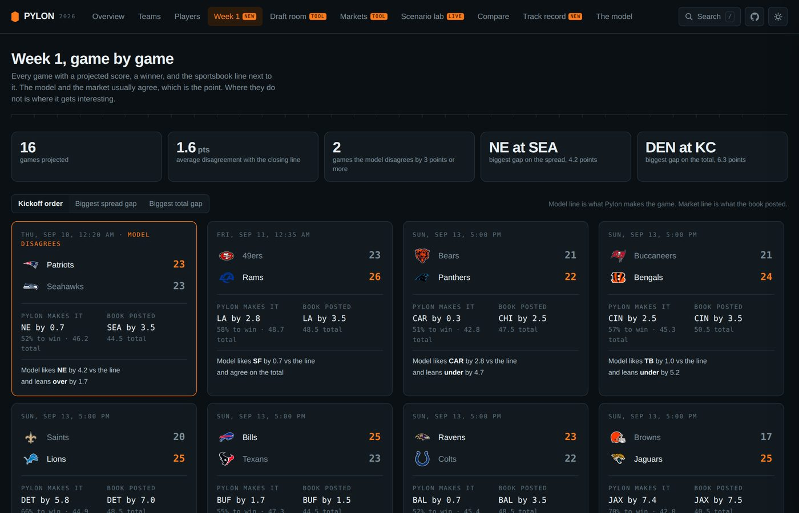
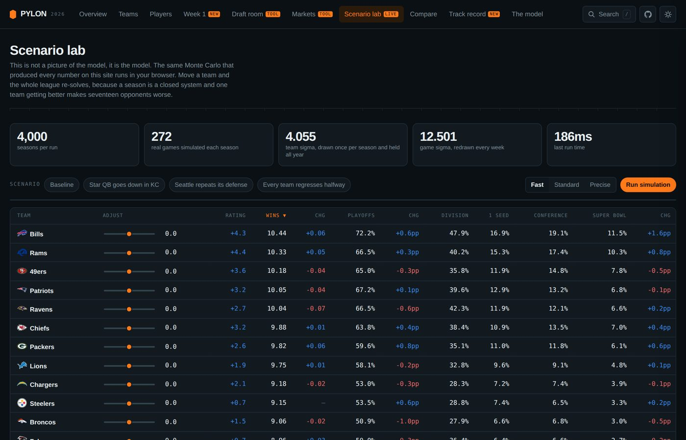
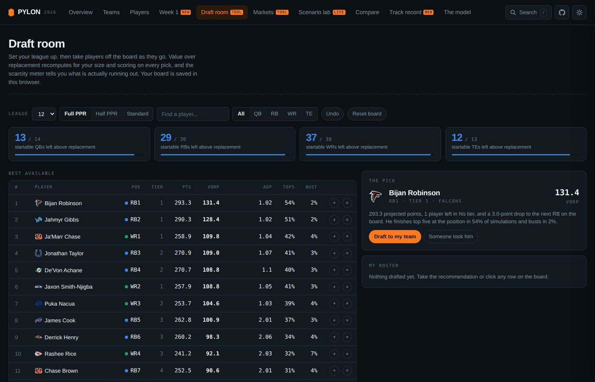
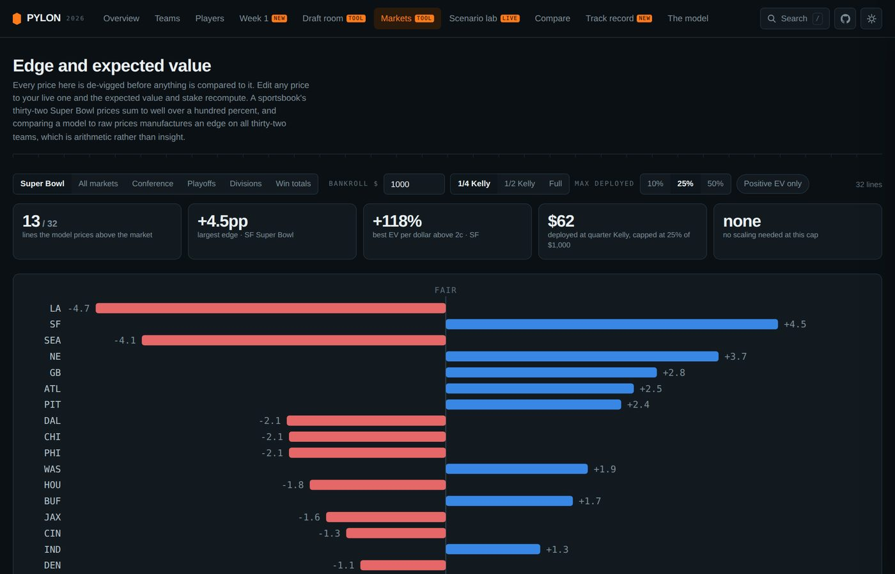

# Pylon

An NFL projection and market-edge engine. Opponent-adjusted ridge ratings on nine
seasons of play-by-play, shrinkage measured out of sample rather than assumed,
25,000 simulated seasons on the real schedule, and a de-vigged comparison against
live prediction markets.

**[Open the live terminal](https://joshuapowers1.github.io/pylon-nfl/)** ·
[How it works](#how-it-works) ·
[The backtest](#the-honest-backtest) ·
[Sealed predictions](#the-sealed-ledger)

[](https://github.com/Joshuapowers1/pylon-nfl/actions/workflows/tests.yml)
[](LICENSE)



---

## The finding

I wanted to know how much of an NFL team's season actually carries into the next one. Not opinions, a number. So I regressed each season's opponent-adjusted efficiency on a blend built only from the three seasons before it, across 2021 through 2025.

| Unit | Carry-over into the next season |
|---|---|
| Offense, passing | **0.57** |
| Offense, rushing | **0.42** |
| Defense, passing | **0.14** |
| Defense, rushing | **0.17** |

Offense is roughly three to four times more repeatable than defense. The betting market prices last year's defense close to face value. That single gap drives nearly every disagreement this model has with the market, including having the defending champions outside the top fifteen.

---

## The honest backtest

Every projection below was built with **zero information from the season it predicts**.

| Metric | Value |
|---|---|
| Team-seasons tested | 160 (2021-2025) |
| Mean absolute error, win totals | **2.39 wins** |
| RMSE | 2.87 wins |
| Correlation, projected vs actual | 0.41 |
| Within 2 wins | 46.9% |
| Straight-up game accuracy | **58.2%** |

Read that honestly. 58.2% straight up is well above a coin flip and well below a closing Vegas line, which lands near 66%. This is a serious estimate that disagrees with the market in specific, defensible places. It is not an edge-printing machine, and any preseason model claiming a much better backtest without publishing this table should be treated with suspicion.

---

## The sealed ledger

The backtest above is retrospective, which is the easy kind of honesty. This is
the other kind.

Every 2026 prediction was written down before the season started, with the
de-vigged closing market number stored beside it, and the file was stamped and
hashed. `out/prediction_ledger.json` holds win totals, playoff, division and
championship probabilities for all 32 teams, plus a spread, total and win
probability for each of the 16 Week 1 games.

```
stamped   2026-08-28T22:48:32Z
digest    ba1a2fa087412d22
```

The digest is a SHA-256 over the sorted-key JSON of the ledger with the digest
field removed, so it can be recomputed by anyone:

```bash
python - <<'PY'
import json, hashlib
led = json.load(open("out/prediction_ledger.json"))
body = {k: v for k, v in led.items() if k != "digest"}
print(hashlib.sha256(json.dumps(body, sort_keys=True).encode()).hexdigest()[:16])
PY
```

Change one probability by 0.0001 and it stops matching. The scoring rules were
fixed at the same time and are stored in the file, so the metric cannot be
chosen after the outcome is known.

`ledger.py` grades it: straight-up accuracy, mean absolute spread error and
Brier score for the model and for the market, on the same games. Anyone can
publish projections. Publishing them where they can be marked, against a
benchmark that was recorded first, is the part that can fail.

The file is write-once. `ledger.build` returns an existing ledger for the season
untouched, and the test suite fails if the digest stops verifying. From Week 2
on, every refit also seals the coming week's game calls into
`out/prediction_ledger_weekly.json` with their own digest, and refuses to seal a
week whose first game has already kicked off. Midseason, win totals are graded
against the August projection pro-rated to the games each team has played,
because half a season of wins cannot be compared with a seventeen-game number.

---

## In-season updating

A preseason rating is a prior. The moment real games exist, quoting week zero all
year is the worst version of the model. So it refits, and the refit is measured
rather than asserted: three completed seasons are replayed week by week, with the
updated ratings rebuilt from only the games already played before predicting the
games that came next.

| | Frozen at week zero | Updated weekly |
|---|---|---|
| Straight-up accuracy | 59.0% | **63.2%** |
| Mean absolute error | 10.96 pts | **10.42 pts** |
| Log loss | 0.668 | **0.639** |

**In-season updating is worth 4.2 percentage points**, which closes most of the gap
to a closing Vegas line at roughly 66%.



The blend is a conjugate-style weight, `rating = w * in-season + (1 - w) * preseason`
with `w = games / (games + k)`. The constant `k` is fitted by sweeping it across
three seasons and keeping whichever value predicted best. It landed on **8**, so this
season earns half the weight after eight games.

The honest detail: through week five the updating model is *worse* than the frozen
one. Four games of data is mostly noise. It takes about six weeks before the season
tells you more than the offseason did, and the weekly curve on the site shows it.

### What the live refit actually does

`inseason.py` is where the blend stops being a backtest and starts feeding every
published number. Each Tuesday, once a week has a final score in every game:

1. **Teams.** This season's plays are run through the same ridge regression and
   blended into the August rating at `w = n / (n + 8)`, per team, so a team coming
   off its bye carries slightly less of this season than one that has not had it.
   The roster prior is scaled by `(1 - w)` with the data, so the decomposition of
   every rating into data and judgment stays true.
2. **Uncertainty.** Under the same normal-normal model, the posterior variance of a
   team's strength is `(1 - w)` times the prior's, so the simulator's team-constant
   draw shrinks by `sqrt(1 - w)`. A rating that has absorbed eight weeks of
   evidence is less uncertain than the one it replaced, and the win distributions
   say so.
3. **Results.** Completed games are not simulated. Their real margin is written
   into every one of the 25,000 seasons, so a 6-1 team is 6-1 in all of them and
   only the games left carry noise.
4. **Context.** Pace, dropback rate and touchdown rate blend the same way, each with
   its own fitted constant.
5. **Players.** Usage shares move toward the measured 2026 share. Efficiency pools
   this season's opportunities into the same empirical-Bayes estimate, which needs
   no new constant. Season totals become points already scored plus a
   rest-of-season projection, and value over replacement is measured on what is
   left, because points already scored are sunk.

The player and context constants were fitted the same way `k` was: replay 2024
and 2025 from the same point in the season (prior from the preceding seasons,
evidence from weeks 1 to 8, scored on weeks 9 to 18) and keep whichever constant
predicted best. Each one beats both of its own ingredients, the prior alone and
the season alone, and a test fails the build if that ever stops being true.

| Blended quantity | Fitted k (games) |
|---|---|
| Target share | **3** |
| Carry share | **1** |
| Dropback share | **6** |
| Plays per game | **24** |
| Dropback rate | **8** |
| Touchdowns per game | **8** |

Roles settle fast and pace barely settles at all: a carry share is mostly this
season's after two games, while plays per game needs the better part of a season
before it outweighs the history. That was not the order I would have guessed.

`.github/workflows/weekly-update.yml` runs the whole refit every Tuesday, re-prices
the live market (`scripts/snapshot_markets.py`), seals the coming week, and
commits the result, so the published site does this on its own.

---

## Quickstart

```bash
git clone https://github.com/Joshuapowers1/pylon-nfl.git
cd pylon-nfl
pip install -r requirements.txt

./scripts/fetch_data.sh            # play-by-play, rosters, schedule, live ADP, Polymarket
PYTHONPATH=src python -m pylon.run --sims 25000 --player-sims 10000
```

Runs end to end in about 22 seconds and writes every published number to `out/`. Then rebuild the web app:

```bash
PYTHONPATH=src python -m pylon.webdata   # pack outputs into a single JSON bundle
cd web && ./build.sh                     # inline the bundle and logos into index.html
node audit.mjs                           # contrast, overflow and clipping: 11 pages, 2 themes, 3 widths
node test.mjs                            # behaviour: every page renders, the glossary resolves,
                                         # and the roster import works from paste, Sleeper and ESPN
```

`build.sh` writes the built page to both `web/index.html` and `docs/index.html`. GitHub Pages serves
from `/docs` on `main`, so the published site is always the file that was just built and tested.

---

## What it produces

| Output | File |
|---|---|
| Power ratings, all 32 teams, in points vs an average opponent | `out/team_power_ratings.csv` |
| Win totals, playoff, division and championship odds | `out/team_projections.csv` |
| Full win distribution, 0 through 17, per team | `out/win_distributions.csv` |
| Playoff seed distribution, 1 through 7 | `out/seed_distributions.csv` |
| Fantasy projections for every rostered skill player: points so far, rest of season, percentile bands and finish probabilities | `out/player_projections.csv` |
| Draft board against 7,726 live PPR drafts, frozen at its preseason build | `out/draft_board.csv` |
| Model vs de-vigged market, every book | `out/market_edge_board.csv` |
| Overround on every market used | `out/market_vig_report.csv` |
| Five-season out-of-sample backtest | `out/backtest_win_projections.csv` |
| How much of each rating is data vs analyst judgment | `out/rating_decomposition.csv` |
| Sensitivity of every projection to the judgment layer | `out/sensitivity_priors.csv` |
| Game-by-game spread, total and win probability vs the posted line | `out/matchups_week{N}.csv` |
| Frozen vs updated accuracy, week by week | `out/inseason_curve.csv` |
| This season's predictions, [sealed and hashed](#the-sealed-ledger) before kickoff | `out/prediction_ledger.json` |
| Each week's game calls, sealed before that week's first kickoff | `out/prediction_ledger_weekly.json` |
| The sealed calls graded against what has happened so far | `out/ledger_score.json` |
| Where the season is: weeks blended, weight, posterior team error | `config/inseason_status.json` |
| Weekly player projections with floor, ceiling and matchup adjustment | `out/weekly_week{N}.csv` |
| The measured streaming premium | `config/streaming_premium.json` |

---

## How it works

### 1. Strip out the schedule

Raw efficiency leaderboards are schedule artefacts. A team that drew six bottom-five defenses looks elite and is not. So instead of averaging expected points added, Pylon regresses it:

```
epa_play ~ b0 + off_team + def_team + home_offense
```

fit separately for pass and rush plays with an L2 penalty, across 81,389 competitive-win-probability plays. Every team gets one offensive and one defensive coefficient per phase, in points per play above league average, with strength of schedule already divided out. Garbage time is excluded by a win-probability band, because kneel-downs and prevent defense carry no predictive signal.

### 2. Shrink by a measured amount

The shrinkage table above is not chosen. It is the slope of a regression of actual on predicted, fit out of sample. Defense regresses far harder than offense because it repeats far less.

### 3. Price the offseason, and publish the receipts

Play-by-play cannot know that a receiver was traded or that a new coordinator is calling plays. Those are hand-priced in `config/offseason_2026.json`, one entry per team, each with a written justification and a documented magnitude scale.

This is the only subjective layer in the engine, so it ships with two audits. `out/rating_decomposition.csv` reports per team how many points of the final rating came from measured data and how many from the prior. `out/sensitivity_priors.csv` re-runs the whole simulation across a grid of prior-confidence weights. Five teams are more than 80% judgment-driven, and the site names them.

### 4. Translate to points, calibrated on real games

Fit on genuine forecasts, not in-sample:

```
expected home margin = 2.05 + 89.77 * (net_rating_home - net_rating_away)
residual sigma = 13.75 points
```

Home-field advantage of 2.05 points is the post-2020 reality, not the historical 2.6 that most public models still carry.

### 5. Simulate, with the uncertainty that actually matters

25,000 Monte Carlo seasons on the real schedule, with the full NFL seeding cascade and the current seven-team bracket.

The detail that separates this from most public simulators: the residual is split in two.

```
sigma_total² = sigma_game² + 2 · sigma_team²
             = 12.50²      + 2 · 4.06²
```

`sigma_team` is drawn **once per team per simulated season** and applied to all seventeen of that team's games. A team that is secretly two points better than its rating is two points better every week, not independently lucky seventeen times. Modelling only game-level noise produces win distributions roughly a third too narrow, which makes every playoff probability overconfident. That value is solved for by matching the simulator's spread to the model's own measured error.

### 6. Project players from opportunity

```
team plays per game
  × dropback rate            ← scheme model, adjusted for new play-callers
  = team pass attempts
  × player target share      ← empirical-Bayes shrunk usage, re-normalised
  = targets
  × catch rate, yards per target
  = receptions, receiving yards
+ the same chain on the ground
+ touchdowns from red-zone opportunity share, never last year's TD count
  = fantasy points
```

Two ideas do most of the work. **Empirical Bayes**: observed share is shrunk toward a depth-chart-aware prior by sample size. **Availability-weighted normalisation**: every team's shares are rescaled so that `Σ(share × games / 17) = 1`, which prices competition for touches as the zero-sum thing it is and makes roster movement work without hand-writing 32 depth charts.

### 7. De-vig before comparing anything

| Book | Outcomes | Raw sum | Overround |
|---|---|---|---|
| Super Bowl (Polymarket) | 32 | 1.0395 | +3.95% |
| Super Bowl (DraftKings) | 32 | 1.2249 | +22.49% |
| AFC Champion (Polymarket) | 16 | 0.9725 | **-2.75%** |
| NFC Champion (Polymarket) | 16 | 0.9815 | **-1.85%** |

A fair book sums to 1.00. Comparing a model to raw sportsbook prices produces an "edge" on all 32 teams, which is arithmetic rather than insight. De-vigging uses the power method, solving for the exponent that makes prices sum to one, because the margin sits disproportionately in the longshots.

Note the two conference books sum to **under** 100%. The same event priced two ways disagrees with itself.

---

## Weekly projections and start/sit

A season projection divided by seventeen is not a weekly projection. Three things
change week to week and none survive an annual average: game script, the actual
opponent, and whether the player is available at all.

Fitting team attempts on the closing spread across 1,632 team-games found the game
script effect is real but very lopsided:

| | Per point of spread | Correlation |
|---|---|---|
| Rush attempts | **-0.25** | -0.21 |
| Pass attempts | +0.07 | +0.06 |

**Favourites do not throw less, they run more. Underdogs do not throw much more,
they just get fewer plays.** A running back's week is therefore far more
matchup-dependent than a receiver's, which is the opposite of how most start-sit
advice is written.

Every player gets a floor, a ceiling and a matchup adjustment, and the head-to-head
answers the only question that matters: how often does A outscore B. Lognormal
rather than normal, because fantasy scoring is bounded below by zero with a long
right tail and a normal model gives a 20-point receiver a real chance of a negative
week.

---

## The number I got wrong

The player model priced replacement level for quarterbacks above the season-long
QB14, on the reasoning that you never had to draft one: you can start whoever has
the best matchup. That is the conventional wisdom and it is why every VORP board
gets overridden by hand.

`streaming.py` replays it rather than assuming it. Each week a simulated manager
starts whichever unrostered quarterback faces the softest pass defense, rated only
on games already played, with no sight of the outcome.

| Season | Streaming | QB at replacement rank | Difference |
|---|---|---|---|
| 2023 | 15.33 | 18.73 | -3.40 |
| 2024 | 18.41 | 18.59 | -0.17 |
| 2025 | 17.52 | 19.11 | -1.59 |

**The premium is minus 1.7, not plus.** Streaming is worse than rostering the player
who ends up at replacement rank: the waiver pool is a real downgrade, not a free
option. So the fudge factor is deleted and the board ranks quarterbacks where the
arithmetic puts them, which disagrees with how most people draft. That disagreement
is the entire reason this project exists.

---

## Your actual roster



Everything else here is about the league. This part is about the fifteen players
somebody owns, because that is the only version of a projection most people will
ever act on.

There are three ways in and the order matters:

- **Sleeper.** Username, pick a league, done. Sleeper's API is public, read-only
  and sends `access-control-allow-origin: *`, so a static page can call it with
  no key and no account. The league's own `roster_positions` come back with it,
  so a superflex league gets a superflex lineup rather than a guess. Every roster
  in the league comes back too, which makes the free agent list the real one
  instead of "good players you do not have".
- **ESPN,** by league id or by pasting the whole league address, for public
  leagues. The read host sends the same CORS header. It reads the league's real
  lineup slots out of `lineupSlotCounts`, the same way the Sleeper path reads
  `roster_positions`, so an ESPN superflex league gets a superflex lineup too,
  and it names each team with its owner so you can find yours. A league exists
  for one season at a time, so a 404 retries against last season before giving
  up. Private leagues need `espn_s2` and `SWID` cookies, which a page on another
  origin cannot send and should not ask for, so those return 401 and the page
  says so plainly and points at the paste box.
- **Paste.** Copy a roster out of any app at all. This one has no network in it
  and therefore cannot break, which is why it is the fallback everywhere else
  fails, including under a content policy that blocks outside connections.

The paste parser walks word windows longest-first against a normalised name
index rather than assuming a layout, so `QB Josh Allen Buf QB1 Bye 7` and
`Tyrone Tracy Jr.` and `Ja'Marr Chase` all resolve, and anything that does not
resolve is reported back by line rather than silently dropped.

What comes out of it: a lineup filled by a greedy pass over slot eligibility,
which for the way fantasy slots nest is the optimal lineup rather than an
approximation; the calls close enough that the head-to-head probability is under
62%, said out loud as coin flips; each starter measured against the player who
would hold that same spot on an average team in that league; a waiver list ranked
by value over replacement rather than raw points, because raw points puts eight
quarterbacks at the top of every waiver list and none of them would improve a
lineup that already has one; and the roster sorted by how far the model sits from
where each player was drafted.



Nothing is uploaded and there is no account. The roster lives in `localStorage`
and the two lookups read public league data only.

`config/sleeper_ids.json` is the id table the import resolves against: 1,115
rosterable players trimmed out of the 4,300 Sleeper carries, refreshed by
`scripts/refresh_sleeper.py` and rebuilt every Tuesday with the rest of the site.

---

## Game by game, every week



A projected score, a winner and a total for every game, with the posted line beside
it in plain English. The margin comes from the calibrated game model and the total
from a fitted scoring model, so the two can never imply an impossible pair of team
scores. Across Week 1 the model sits within 1.6 points of the closing line on
average, which is what should happen: a preseason model that routinely disagreed
with the market by a touchdown would be broken, not brilliant. From Week 2 the page
follows the week the refit projected, with that week's DraftKings line beside each
game, and the calls are sealed before the first kickoff.

---

## The web terminal



A single self-contained HTML file. No framework, no chart library, no build step in the browser. Every chart is hand-built SVG and the full data bundle plus all 32 logos are inlined. The only network calls the page ever makes are the two optional roster lookups, and every page works with those blocked.

**Scenario lab.** The season Monte Carlo reimplemented in JavaScript: same team-constant strength draw, per-game noise, real 272-game schedule, division tiebreakers, seven-team bracket. 4,000 seasons in roughly 360ms. It reproduces the Python engine to within about 0.06 wins and one percentage point on playoff odds, which is itself the regression test. Drag a rating and all 32 teams re-solve.

**My team.** Roster import from Sleeper, a public ESPN league, or pasted text, then a lineup, the close calls, the thin spots and the waiver board. Described in full above.

**Draft room.** Value over replacement recomputed for league size and scoring on every pick, so twelve-team full PPR and ten-team standard produce genuinely different boards. Tier breaks, and scarcity measured as startable players remaining above replacement. Persists to `localStorage`.



**Markets.** Power-method de-vig, then expected value and Kelly sizing against an editable price. Kelly is shown as a fraction and there is no dollar column, because these markets are nested rather than independent and a stake figure summed line by line across them reads as advice the backtest does not support.



---

## Repository layout

```
pylon-nfl/
├── config/
│   ├── offseason_2026.json         32 roster and scheme priors, each justified
│   ├── roles_2026.json             58 player role priors: rookies, injuries, role changes
│   ├── market_snapshot_2026.json   August Polymarket and sportsbook prices the ledger was sealed against
│   ├── market_snapshot_live.json   the same books re-priced by every refit, plus this week's lines
│   ├── inseason.json               fitted team blend constant k
│   ├── inseason_players.json       fitted usage and context blend constants, with both baselines
│   ├── sleeper_ids.json            trimmed id table the roster import resolves against
│   ├── calibration.json            fitted shrinkage and translation constants
│   └── backtest.json               out-of-sample results and the variance split
├── src/pylon/
│   ├── config.py                   every tunable, with the reason it exists
│   ├── ingest.py                   play-by-play → clean plays + team context
│   ├── usage.py                    per-player opportunity shares
│   ├── ratings.py                  ridge opponent adjustment
│   ├── calibrate.py                fits shrinkage and translation out of sample
│   ├── backtest.py                 five-season replay, solves the variance split
│   ├── adjustments.py              2026 context projection + analyst priors
│   ├── update.py                   in-season replay that fits the team blend
│   ├── inseason.py                 the live blend: teams, context, players, to-date stats
│   ├── game_model.py               ratings → spread → win probability
│   ├── simulate.py                 25,000-season Monte Carlo with real tiebreakers
│   ├── players.py                  opportunity-based fantasy projections
│   ├── draft.py                    model vs live ADP
│   ├── market.py                   de-vigging and the edge board
│   ├── platforms.py                Sleeper and ESPN roster import support
│   ├── diagnostics.py              decomposition and sensitivity
│   ├── charts.py                   broadcast visuals
│   ├── webdata.py                  packs outputs into the web bundle
│   └── run.py                      orchestrator
├── web/
│   ├── app.template.html           source for the terminal
│   ├── build.sh                    injects data + logos → index.html
│   └── test.mjs                    headless Playwright check
├── scripts/
│   ├── fetch_data.sh               play-by-play, rosters, schedule, ADP, market
│   ├── snapshot_markets.py         live Polymarket books + DraftKings week lines
│   └── refresh_sleeper.py          rebuilds config/sleeper_ids.json
└── out/                            every published number
```

---

## Bugs found and fixed during development

Kept here deliberately. Each was silently producing wrong answers, and each is the kind of error a projection system can carry for a full season without anyone noticing.

1. **Season-total denominators.** Target and carry shares were divided by full-season team totals, so any player who missed games looked like he had lost a third of his role. One receiver's target share read 12% instead of 33%. Fixed by computing team opportunity only over the games each player actually played. This single fix moved dozens of players 60+ draft slots.

2. **Vanishing quarterback scrambles.** A scramble is charged as a dropback, so it never lands in the rushing bucket, and nflverse credits it to `rusher_player_id` rather than `passer_player_id`, so it never lands in the passing bucket either. It fell through both. That is roughly 40% of a mobile quarterback's carries and 70% of his rushing yards.

3. **Flat positional priors.** Every rostered receiver was given a 5.5% target-share prior. Twelve receivers × 5.5% sums past 100% of a team's targets before a single starter is counted, and the normalisation step then halved everybody. Replaced with depth-chart-aware priors.

4. **Double-taxed availability.** Quarterback dropback share was set to 0.90 to account for missed time, then multiplied by a projected games figure that already accounted for missed time. Every quarterback was penalised twice.

5. **Naive share normalisation.** Normalising shares to sum to 1.0 taxes every healthy starter to pay for the projected absences of his own backups. Replaced with the availability-weighted identity.

6. **Overconfident simulation.** The original simulator modelled only game-level noise and produced a mean win standard deviation of 2.00 against a measured out-of-sample error of 2.87. It was claiming 44-point probability edges that were mostly its own false precision.

7. **Unsourced vig figure.** The DraftKings overround was quoted in prose rather than computed, so the one number contrasting the two markets was not reproducible from the repo. It is now stored as American odds and converted by the same code path as everything else.

8. **Silent ADP join failure.** The player-to-ADP join matched on raw name, so "James Cook" versus "James Cook III" dropped ADP for around fifty players. Now joins on a normalised key.

9. **Kelly sizing across nested markets.** The market page summed line-by-line Kelly stakes across 160 correlated lines and reported "189% of bankroll deployed". Those markets all resolve off the same season. It now caps deployment and discloses the scaling factor.

The next five were found in November, by running the Tuesday job against a real
half-played season instead of against the week it was written in. None of them
crashed. Every one of them would have published a number that looked fine.

10. **The weekly refit refit nothing.** `update.py` proved that blending the season into the rating helps, and then nothing called it. The job reloaded the August ratings every week and moved the matchup page forward. Now `inseason.py` does the blend and every published number runs through it.
11. **The simulator ignored results.** It re-rolled all 272 games every Tuesday, so a team that had started 0-7 kept its August playoff odds minus whatever the rating shift caught. Completed games are now locked to their real margin.
12. **The sealed ledger would have been re-sealed.** `run.py` called `ledger.build` on every refit, and `build` overwrote the file with that week's numbers under a new timestamp. The August predictions would have been replaced by November ones, which is the one thing the ledger exists to prevent. It is write-once now, and a test checks the digest.
13. **The site could not show any week but Week 1.** `webdata.py` read `matchups_week1.csv` by name and the bundle never carried the week number the page was waiting for, so a Week 2 refit wrote Week 2 files that nothing loaded.
14. **The draft board would have eaten itself.** In season the ADP feed thins to a few mock drafts (two players, on the day I checked). Rebuilding the board on that strips the ADP from every player on the site. The board now freezes at its preseason build once a week is complete.

---

## Colour is checked, not eyeballed

`web/audit.mjs` walks all eleven pages in both themes at three widths and
computes contrast against the ground each element actually sits on, not the one
it nominally sits on. It exits non-zero and CI gates on it.

The first run found **70 failures**, almost all of them in the small grey labels
that carry the explanations, which is the worst place to be under-contrast. Four
things came out of fixing them and they are worth stating as rules:

1. A colour chosen to work as a **fill** is not automatically legible as **text**.
   The sequential-ramp green was printing a 24px number at 2.5:1 because nobody
   had asked. Semantic status colours are now their own tokens, and the bar keeps
   the ramp while the number takes the semantic set.
2. The same split applies to the categorical series, which the comparison views
   use as direct labels rather than as a legend.
3. A tinted chip under a word is a tighter contrast problem than the same colour
   on a plain surface, so the direction pills have their own text tokens.
4. One accent value has to clear both being read as text and carrying white text
   on top of it. That moved the orange from `#DB5A00` to `#B54900`.

---

## Known limitations

1. **The judgment layer is judgment.** Five teams are more than 80% prior-driven. Those projections are opinions with a model attached, and `rating_decomposition.csv` names them.
2. **Defensive ratings are nearly information-free from data alone.** With a measured carry-over of 0.14, play-by-play supplies almost no defensive differentiation, so the prior does proportionally more work there.
3. **The in-season blend weight is fitted on three seasons, not on this one.** Ratings do refit weekly, and `k` was chosen out of sample, but a season with a genuinely unusual shape would want a different weight and this would not find that out until it was over.
4. **Point totals are risk-adjusted, not healthy-season.** Expected games played is projected rather than assumed at 17, which is why totals sit below published industry sets. A 17-game column is provided for like-for-like comparison.
5. **The engine ranks quarterbacks earlier than the market does.** This was previously listed as a known flaw, on the assumption that streaming made replacement level higher. Measuring it found the opposite, so the adjustment is gone and the disagreement stands. It may still be wrong, but it is now wrong on the evidence rather than on a hunch.
6. **Rookies and role-changers are asserted, not measured.** 58 of them, each with a stated reason.
7. **The roster import cannot see a private ESPN league.** That needs `espn_s2` and `SWID` cookies, which a page on another origin cannot send and has no business asking for, so those leagues fall back to paste. Sleeper has no such limit because its read API is genuinely public.
8. **The team model has no injury layer.** Ratings move on plays, not on who is playing them, so a starting quarterback ruled out on Wednesday shows up in the line long before it shows up here. The biggest model-versus-market gaps in a given week are usually this, not insight.
9. **Reserve lists count as out until the player is activated.** The roster file says a player is on injured reserve but not when he is due back, so his rest-of-season projection is zero until he is activated. That is conservative on purpose: counting a player back too early is the worse error for a lineup.

---

## Data sources

- **Play-by-play, rosters, schedule** - [nflverse](https://github.com/nflverse/nflverse-data), 2017-2025, plus 2026 to date, re-pulled every refit
- **Weekly game lines** - ESPN scoreboard feed, DraftKings provider
- **Average draft position** - FantasyFootballCalculator API, 12-team full PPR, 7,726 drafts
- **Prediction markets** - Polymarket Gamma API, order-book midpoints
- **Sportsbook lines** - DraftKings board, converted from American odds

## Disclaimer

Provided as is, without warranty of any kind. Nothing in this repository or on the site is
financial, investment, betting or professional advice, and no output is a recommendation to place
a wager or make a transaction. The model publishes its own error rate precisely because that rate
is high: roughly 58 games in 100 called correctly, against about 66 for a closing sportsbook line.
Sports wagering is legal only where expressly permitted, is age restricted, and carries a real risk
of loss. US national helpline: 1-800-GAMBLER.

This is an independent analytical project with no connection to, sponsorship from, or endorsement
by the National Football League, any member club, Sleeper, ESPN, DraftKings, Polymarket or any
other named service. Team names, logos and marks are the property of their respective owners and
appear solely for identification. The optional roster lookups read publicly available league data
at the visitor's own direction and are subject to those services' own terms.

No personal data is collected. Rosters entered on the site stay in the visitor's own browser, are
never uploaded, and there is no account.

---

## Author

**Joshua Powers**

[joshpowersbiz@gmail.com](mailto:joshpowersbiz@gmail.com) · [LinkedIn](https://www.linkedin.com/in/joshuampowerss) · [Instagram](https://instagram.com/joshuampowers) · [GitHub](https://github.com/Joshuapowers1)

If you disagree with a number, the code that produced it is right here. I would rather hear the argument than not.

Released under the [MIT License](LICENSE).
